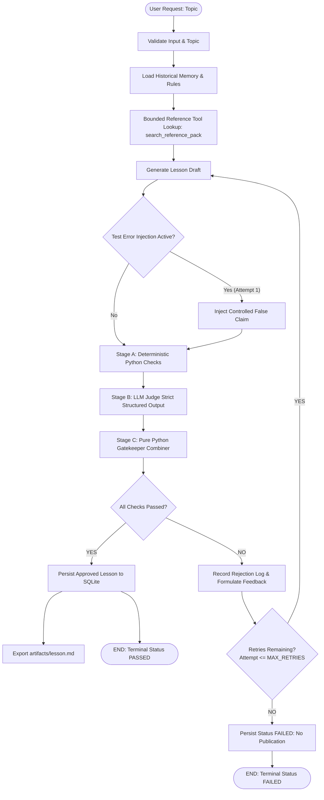

# Agentic Content Evaluator

> **Self-Evaluating Educational Content Generation Engine with Multi-Stage Quality Gating and Cross-Run Memory**

[](https://agentic-content-evaluator.onrender.com)

[](https://github.com/Vaibhavsahkk/agentic-content-evaluator/actions)


> 🌐 **Live Application URL**: [https://agentic-content-evaluator.onrender.com](https://agentic-content-evaluator.onrender.com)

---

## 1. Project Overview

**Agentic Content Evaluator** is an autonomous, self-evaluating lesson generation engine designed to create rigorous, accessible technical curriculum.

Rather than relying on single-shot LLM prompts (which frequently hallucinate, skip edge cases, or introduce subtle factual errors), the system executes a stateful **Generate → Evaluate → Reject & Formulate Feedback → Regenerate → Final Decision** workflow. Every generated draft must pass an uncompromising **3-Stage Hybrid Quality Gate** before publication. If a draft fails any check, the system isolates the failure, logs the exact offending span and remediation advice into persistent storage, and routes the draft back through a bounded self-correction loop.

### Core Capabilities
- **State Machine Flow Control**: Built on an explicit LangGraph `StateGraph` with typed state, linear validation steps, and conditional retry routing.
- **3-Stage Hybrid Quality Gate**: Combines sub-millisecond deterministic Python checks (regex, structure, citation verification, jargon scanning) with an LLM-as-a-Judge enforcing strict JSON schema, crowned by a pure Python gatekeeper combiner with zero model override.
- **Bounded Reference Retrieval**: Queries verified primary reference literature via structured tool calling, preventing unbounded web hallucinations.
- **Self-Evolution & Cross-Run Memory**: Stores attempt histories, rejection records, and learned editorial rules in SQLite (WAL mode), dynamically sharpening future generations.
- **Deterministic Error Injection & Recovery**: Includes a verifiable test mode that injects controlled false statements to prove evaluator detection, rejection logging, and regeneration recovery.
- **Production Full-Stack Studio**: Features a FastAPI backend serving a responsive React 19 dashboard for real-time generation monitoring, inspection of evaluation checkpoints, and rejection history audits.

---

## 2. Architecture & State Machine

The core orchestration engine is modeled as an explicit state machine using **LangGraph**:



### Architectural Highlights

1. **Explicit State Graph (`backend/app/graph/`)**: Manages typed state (`LessonGraphState`) across discrete nodes with isolated responsibilities, avoiding monolithic scripts.
2. **Bounded Reference Tool (`backend/app/tools/reference_lookup.py`)**: The generator queries curated, verified source documents (`REF-01` through `REF-04`) in memory with strictly bounded results. Zero arbitrary filesystem or shell access.
3. **Stage A Deterministic Checks (`backend/app/evaluation/deterministic.py`)**: High-speed Python validation scanning for required markdown sections, concrete worked examples, citation coverage, unexplained jargon, reading ease, and banned false statements.
4. **Stage B LLM Judge (`backend/app/evaluation/llm_judge.py`)**: Strict structured evaluation across six pedagogical dimensions using Groq's low-latency inference engine with recursive schema validation.
5. **Stage C Gatekeeper Combiner (`backend/app/evaluation/combiner.py`)**: Pure Python code computes final pass/fail decisions. Model outputs can never bypass hard safety and quality thresholds.
6. **Self-Evolution Engine (`backend/app/database/repository.py`)**: SQLite with Write-Ahead Logging (WAL) captures failure patterns to propose candidate editorial rules that guide subsequent prompts.

---

## 3. The Multi-Stage Quality Gate

Every lesson draft is evaluated against **six pedagogical and technical dimensions** with zero partial credit:

| Checkpoint ID | Dimension | Verification Method | Enforcement |
|---|---|---|---|
| `accurate_and_grounded` | Technical Accuracy & Citations | Primary literature citations (`REF-01` to `REF-04`) + False statement regex | Zero tolerance for factual distortion (e.g. claiming retrieval retrains weights). |
| `beginner_friendly_language` | Accessible Vocabulary | Automated readability analysis + LLM Judge | Short sentences, active voice, everyday words suitable for foundational learners. |
| `teaches_by_example` | Relatable Worked Example | Regex example detection + LLM Judge | Concrete, end-to-end worked scenarios with relatable everyday analogies. |
| `clear_no_unexplained_jargon` | Pre-defined Terminology | Jargon vocabulary scanner + LLM Judge | Terms like embeddings, chunking, and vectors must be introduced with clear analogies before use. |
| `covers_the_key_points` | Core Concept Coverage | Structural header regex + LLM Judge | Requires: What it is, Why it matters, How it works, Worked example, Limitations, and Recap. |
| `coherent_teaching_flow` | Logical Progression | Structural section ordering + LLM Judge | Intuitive progression from motivation to mechanics to practical application. |

---

## 4. Quick Start & Execution Guide

### Prerequisites
- Python 3.12 or 3.13
- Node.js 18+ and npm
- GroqCloud API Key (Free tier): [https://console.groq.com/keys](https://console.groq.com/keys)

### 1. Installation

```bash
# Clone the repository
git clone https://github.com/Vaibhavsahkk/agentic-content-evaluator.git
cd agentic-content-evaluator

# Install Python dependencies
pip install -r requirements.txt

# Configure environment variables
cp .env.example .env
# Edit .env and set your GROQ_API_KEY
```

### 2. Run Automated Test Suite (38 Tests Passing Offline)

The entire test suite runs 100% offline using deterministic mock providers without requiring API keys or consuming quota:

```bash
python -m pytest tests/ -v
```

### 3. Command-Line Interface (CLI)

```bash
# Offline Mock Run (Instant verification without API key)
python backend/app/cli.py --offline

# Offline Error Injection Demonstration (Shows rejection logging & self-healing)
python backend/app/cli.py --offline --demo-error

# Live LLM Run via Groq
python backend/app/cli.py --topic "Introduction to RAG"

# Live Error Injection Demonstration via Groq
python backend/app/cli.py --topic "Introduction to RAG" --demo-error
```

### 4. Full-Stack Web Application (FastAPI + React Dashboard)

#### Single-Command Unified Server:
FastAPI automatically serves the production-built React frontend at `http://127.0.0.1:8000`:

```bash
# Build frontend assets
cd frontend
npm install
npm run build
cd ..

# Start the unified FastAPI server
python -m uvicorn backend.app.main:app --host 127.0.0.1 --port 8000
```
Open **[http://localhost:8000](http://localhost:8000)** in your browser.

#### Dual Development Mode (with Vite HMR):
- **Backend API**: `python -m uvicorn backend.app.main:app --port 8000 --reload`
- **Frontend Dev**: `cd frontend && npm run dev` (Runs on `http://localhost:5173` with proxy to backend)

---

## 5. Deliberate Error Detection & Recovery Showcase

To demonstrate the reliability of the quality gate, the pipeline includes an **"Inject Test Error"** mode:

1. **Error Injection**: On Attempt 1, a controlled false claim is inserted into the draft:
   > *"A key advantage of RAG is that it retrains the language model's weights every time it retrieves a document from the external database."*
2. **Evaluator Detection**:
   - Stage A deterministic check `check_controlled_false_claim` flags the statement.
   - Stage B LLM Judge fails `rubric:accurate_and_grounded`.
   - Stage C Gatekeeper marks the attempt `REJECTED` and commits a structured audit entry to `rejection_logs`.
3. **Automated Feedback & Regeneration**:
   - Actionable remediation advice is provided to the generator for Attempt 2.
   - The test error injection is disabled for subsequent attempts.
4. **Approval & Persistence**:
   - Attempt 2 is re-evaluated anew across all dimensions, clears the quality gate, and is marked `PASSED`.

---

## 6. Project Structure

```text
agentic-content-evaluator/
├── README.md                           # Master project documentation
├── pyproject.toml                      # Python package & pytest configuration
├── requirements.txt                    # Python dependencies
├── .env.example                        # Environment variable templates
├── .gitignore                          # Git exclusions
├── .github/
│   └── workflows/
│       └── ci.yml                      # GitHub Actions CI workflow (tests + build)
├── backend/
│   └── app/
│       ├── main.py                     # FastAPI app with static frontend mounting
│       ├── cli.py                      # CLI runner for offline & live runs
│       ├── core/
│       │   ├── config.py               # Pydantic Settings with secret redaction
│       │   ├── logging.py              # Secret-redacting logger
│       │   └── security.py             # Prompt injection defense & input validation
│       ├── schemas/
│       │   ├── lesson.py               # Lesson draft & section models
│       │   ├── evaluation.py           # StrictBool rubric models & rejection records
│       │   ├── reference.py            # Primary source & tool query schemas
│       │   ├── run.py                  # API request/response models
│       │   └── evolution.py            # Learned rules & proposals schemas
│       ├── database/
│       │   ├── connection.py           # SQLite connection with WAL mode
│       │   ├── schema.sql              # Normalized SQLite database schema
│       │   └── repository.py           # CRUD operations for runs, evals, memory
│       ├── reference_pack/
│       │   ├── rag_reference.json      # Curated primary source documents
│       │   └── loader.py               # In-memory pack loader & bounded search
│       ├── tools/
│       │   └── reference_lookup.py     # search_reference_pack tool spec & bridge
│       ├── providers/
│       │   ├── base.py                 # Abstract LLMProvider interface
│       │   ├── groq_provider.py        # Direct Groq SDK with 429 backoff
│       │   └── mock_provider.py        # Deterministic offline mock provider
│       ├── prompts/
│       │   └── generator_prompt.py     # Pedagogical persona & regeneration prompts
│       ├── evaluation/
│       │   ├── deterministic.py        # Stage A deterministic Python checks
│       │   ├── llm_judge.py            # Stage B 6-checkpoint structured judge
│       │   └── combiner.py             # Stage C pure Python approval gate
│       ├── graph/
│       │   ├── state.py                # Typed LessonGraphState
│       │   ├── nodes.py                # 8 discrete LangGraph execution nodes
│       │   ├── edges.py                # Conditional routing & retry boundaries
│       │   └── workflow.py             # StateGraph compiler & workflow runner
│       └── api/
│           └── routes.py               # FastAPI REST API endpoints
├── frontend/
│   ├── src/
│   │   ├── App.jsx                     # Interactive React dashboard with 5 tabs
│   │   ├── main.jsx                    # React entry point
│   │   └── index.css                   # Custom theme & utility styles
│   ├── vite.config.js                  # Vite configuration with proxy to 8000
│   └── package.json                    # Frontend dependencies
├── tests/
│   ├── conftest.py                     # Pytest isolated temporary DB fixture
│   ├── unit/
│   │   ├── test_schemas.py             # StrictBool & model validation tests
│   │   ├── test_database.py            # SQLite CRUD & memory persistence tests
│   │   ├── test_reference_pack.py      # Reference pack bounds & search tests
│   │   ├── test_security.py            # Prompt injection & input sanitization tests
│   │   └── test_deterministic_eval.py  # Stage A deterministic checks tests
│   ├── graph/
│   │   ├── test_graph_execution.py     # Single-pass, recovery, & retries tests
│   │   └── test_deliberate_error.py    # Deliberate error detection & recovery test
│   └── api/
│       └── test_api.py                 # FastAPI TestClient endpoint tests
└── docs/
    ├── architecture.md                 # System architecture & state machine diagrams
    ├── evaluation-rubric.md            # Detailed rubric checkpoints specification
    ├── decisions.md                    # Architecture Decision Records (ADRs)
    ├── assumptions-and-decisions.md    # Technical assumptions and rationale
    ├── content-maintenance.md          # Source freshness & defect tracking policy
    └── r-and-d-notes.md                # Model experimentation & latency benchmarks
```

---

## 7. Technical Documentation

For deeper architectural details, refer to the documents in `docs/`:
- [Architecture & Design Specification](docs/architecture.md) — Node definitions, typed state schema, and data flows.
- [Evaluation Rubric & Quality Gating](docs/evaluation-rubric.md) — Rubric criteria, evidence extraction, and deterministic rules.
- [Architecture Decision Records (ADRs)](docs/decisions.md) — Technical tradeoffs and design rationale.
- [Assumptions & Technical Decisions](docs/assumptions-and-decisions.md) — System constraints, reversibility, and component choices.
- [Content Maintenance & Freshness](docs/content-maintenance.md) — Curated primary sources and freshness policies.
- [R&D Notes & Experiments](docs/r-and-d-notes.md) — Findings on strict schema modes, rate limit backoff, and citation grounding.

---

## 8. License

This project is licensed under the MIT License — see the LICENSE file for details.
