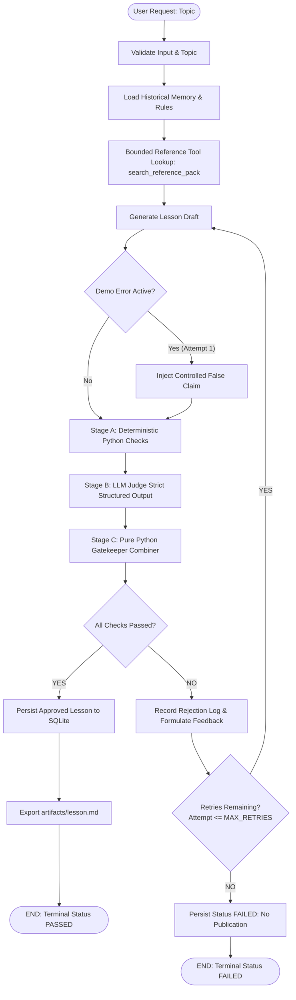

# System Architecture & Design Specification

## 1. High-Level Overview

The **Agentic Content Evaluator** is a production-grade agentic system designed for automated curriculum generation and quality assurance. It autonomously generates, evaluates, rejects, and regenerates technical lessons for foundational learners, ensuring 100% adherence to quality and factual accuracy gates before publication.

---

## 2. Core Execution Engine: LangGraph State Machine

The workflow is implemented using an explicit **LangGraph `StateGraph`** with typed state (`LessonGraphState`), avoiding monolithic procedural scripts and enabling fully inspectable transitions:

| Node Name | Function | Responsibility |
|---|---|---|
| `validate_input` | `validate_input_node` | Validates input length (<200 chars), sanitizes text, scans for prompt injection patterns, creates initial run record in SQLite. |
| `load_context_and_memory` | `load_context_and_memory_node` | Retrieves approved editorial guidance rules from SQLite cross-run memory and loads curated reference pack metadata. |
| `retrieve_references` | `retrieve_references_node` | Executes model tool-calling via `search_reference_pack` with fallback to bounded keyword retrieval. |
| `generate_lesson` | `generate_lesson_node` | Invokes generator prompt with learner persona guidelines. On attempt > 1, incorporates previous rejection feedback. |
| `inject_deliberate_error` | `inject_deliberate_error_node` | Isolated demo path: Injects controlled false claim on Attempt 1 only when `--demo-error` flag is set. |
| `evaluate` | `evaluate_node` | Executes Stage A deterministic checks, Stage B strict structured LLM evaluation, and Stage C Python combiner. |
| `record_rejection` | `record_rejection_node` | Persists detailed failure reasons and corrective feedback to SQLite `rejection_logs` and proposes self-evolution candidate rules. |
| `persist_final_state` | `persist_final_state_node` | Records final run outcome (`PASSED` or `FAILED`) and stores approved lesson only if genuinely passed. |

---

## 3. Bounded Reference Lookup Tool

To prevent open-ended hallucinations and tool misuse, the reference search tool `search_reference_pack` is strictly constrained:
- **Allowlist Only**: Searches exclusively within `backend/app/reference_pack/rag_reference.json`.
- **Bounded Results**: Accepts `query` (str) and clamps `max_results` between 1 and 5 (default 3).
- **Zero Shell / FS / Code Access**: Operates entirely in memory with no filesystem traversal, network calls, or arbitrary code execution.
- **Auditable**: Every reference returned is logged with verified source IDs (`REF-01`, `REF-02`, `REF-03`, `REF-04`).
- **Tool-Calling Architecture (F-07)**: Operates via a model-driven query extraction pattern. The model decides what topics to query via the `search_reference_pack` tool call; Python validates arguments, retrieves matching excerpts from the verified reference pack, and injects the formatted context directly into the downstream generator prompt.

---

## 4. Hybrid Two-Stage Evaluator

The quality gate separates deterministic objective constraints from semantic qualitative assessment:

### Stage A: Deterministic Python Checks
1. **Content Completeness**: Draft must not be empty and exceed 200 characters.
2. **Controlled False Claim Detection**: Regex check catching affirmations of *"RAG retrains model weights every time it retrieves"*.
3. **Mandatory Sections**: Checks presence of What is RAG, Why it matters, How it works, Worked example, Limitations, and Recap.
4. **Worked Example Verification**: Detects concrete Indian student scenarios (college, library, handbook, semester fees).
5. **Reference Citations**: Resolves all cited `[REF-XX]` tags against known reference pack source IDs.
6. **Jargon Explanation**: Checks that technical terms (`embedding`, `chunk`, `vector`) have nearby plain-English definitions or analogies.
7. **Readability Sentinel**: Flags sentences exceeding 45 words that impair beginner comprehension.

### Stage B: LLM-as-a-Judge (Groq Strict JSON Schema)
Evaluates the 6 mandatory take-home dimensions using Groq's strict schema subset:
1. `accurate_and_grounded`
2. `beginner_friendly_language`
3. `teaches_by_example`
4. `clear_no_unexplained_jargon`
5. `covers_the_key_points`
6. `coherent_teaching_flow`

### Stage C: Application Combiner
Calculated in pure Python:
$$\text{Pass} = \left(\bigwedge_{i} \text{det\_check}_i\right) \land \left(\bigwedge_{j=1}^{6} \text{rubric\_checkpoint}_j\right)$$
If any single check fails, publication is blocked, and actionable feedback is routed to the generator.

---

## 5. Bounded Regeneration & Max Retries Policy

- Initial attempt + maximum 2 content retries = **Maximum 3 total attempts**.
- On failure, rejection record is created capturing:
  - Exact failed checkpoints
  - Specific failure reasons
  - Actionable correction instructions
  - Previous draft excerpt
- On Attempt 3 failure, the workflow terminates with status **`FAILED`**.
- **Crucial Rule**: A failed lesson is **NEVER** marked as approved or exported to `artifacts/lesson.md`.

---

## 6. Durable SQLite Persistence & Schema

Data survives application restarts using SQLite WAL mode (`data/app.db`):
- `runs`: Run ID, topic, status, models, versions, timestamps.
- `run_attempts`: Individual draft history per attempt.
- `deterministic_checks`: Attempt-level objective check results.
- `rubric_checks`: Attempt-level LLM rubric scores and evidence.
- `rejection_logs`: Comprehensive rejection audit trail.
- `learned_rules`: Persisted candidate and approved editorial rules.
- `improvement_proposals`: Tracked prompt and rubric version diffs.
- `content_issues`: Freshness issue tracker (outdated concepts, broken syntax).
- `user_feedback`: Learner ratings and comments.

---

## 7. Security Safeguards

- **Prompt Injection Defense**: Pre-flight regex and heuristic scanning per OWASP LLM01:2025 (`security.py`).
- **Data Boundary Wrapping**: Untrusted inputs (topic, user feedback, retrieved texts) are wrapped in `<UNTRUSTED_*_DATA>` fences preventing instruction escape.
- **Secret Redaction**: API keys and secrets (`gsk_...`) are automatically redacted from console logs and tracebacks via `SecretRedactingFormatter`.
